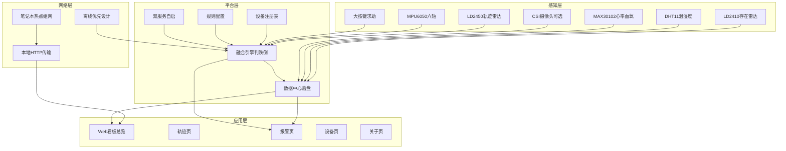
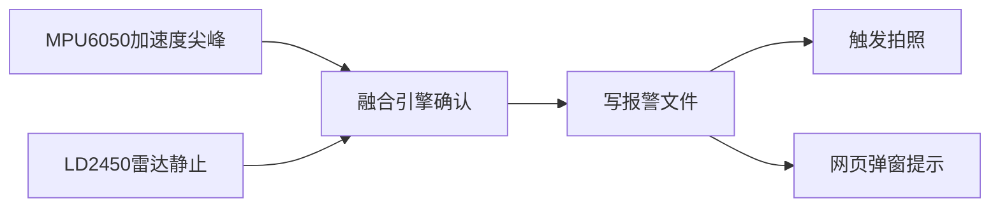

# 基于树莓派加毫米波雷达的老人跌倒监护原型：物联网四层架构说明

> 题目：基于树莓派加毫米波雷达的老人跌倒监护原型（边缘计算）
> 主控：树莓派 4B 加 Python
> 状态：L1 闭环已通（2026.09.26），演示就绪
> 用法：验收时一层一指，报告直接抄。验收占 50 分，报告占 30 分，考勤占 20 分。

## 0. 总览：一句话讲清系统

LD2450 看人在哪、融合算法判摔没摔，DHT 加 MPU 加 MAX30102 采环境体征，大按键求助，树莓派本机独立判断加网页看板，断网照样报警。

跌倒事件数据流链路：

## 1. 感知层：所有摸得到的数据来源

### 组成

感知层负责采集物理信号。按课程定义，传感器、执行器、摄像头都算这一层。

### 本项目实现

| 模块 | 接口与参数 | 采集内容 | 实测状态 |
|---|---|---|---|
| LD2450 轨迹雷达 | UART2，波特率 256000 | 多目标坐标加速度，人在哪、动没动 | 已通，0.4 米跟手验证过 |
| LD2410 存在雷达 | UART4，波特率 256000 | 有人无人，学长遗留通道 | 在流，正常 |
| DHT11 温湿度 | GPIO5 单总线 | 温度湿度，约24℃/47%上下（以看板实时值为准） | 已通 |
| MPU6050 六轴 | 硬 I2C bus1，地址 0x68 | 加速度尖峰、计步、活动量 | 已通 |
| MAX30102 心率血氧 | 软 I2C bus4，地址 0x57 | 心率血氧，需手指夹住才准 | 已通，无指夹时是野值，别信 |
| 三脚有源大按键 | GPIO17，VCC 接 3V3，空闲 LOW，按下 HIGH | 一键求助 | 已通，逻辑已取反适配 |
| CSI 摄像头 | CSI 排线 | 报警时拍照留证 | 已通，1296x972实拍清晰；演示前对准跌倒区域 |

60MI01 说明：HLK-60MI01 原计划做专用跌倒雷达，现已封存。原因是四个波特率双向测试全零，疑似模块损坏，学长也没有接通过。跌倒判断改用 LD2450 静止突变加 MPU 加速度融合实现，功能不受影响。

### 对应文件

- 派上 `main.py`（本机快照 `main_pi.py`）：SharedState 全局状态加 4 个 worker 线程（mpu 计步、ld2410 存在、ld2450 轨迹、max30102 心率血氧）加 sensor_loop 主循环
- `fall_fusion.py`：纯函数加 FallDetector 类，无硬件依赖，可单机自测
- `sensor_test.py`、`test_ld_radars.py`、`test_max30102.py`：单点验证脚本
- `test_radar.py`：60MI01 跌倒帧解析底稿，封存备用

### 对应得分项

- 验收第一层 65 到 75 分（单点跑通）：已过，6 种传感器单点全活
- 加分传感器超过 3 种加 5 分：已拿，6 种超标（LD2450、LD2410、DHT11、MPU6050、MAX30102、大按键）

## 2. 网络层：派和人之间怎么连

### 组成

网络层负责连通性。含组网方式、传输协议、断网策略。

### 本项目实现

- 组网：笔记本开 Windows 移动热点 ICS，SSID 为 <你的热点SSID>，网段 192.168.137.x，树莓派固定地址 <树莓派IP>。注意是电脑热点，不是手机热点。电脑息屏或超时可能关热点，掉线先查电脑端。
- 传输：本地 HTTP 传输。主循环每 2 秒写 `status.json`，报警追加写 `alarms.jsonl`，看板服务开 8080 端口，同热点下电脑或手机浏览器直接看。
- 离线优先：断网本地照样报警。融合判断、落盘、拍照全在派本机，不依赖外网。学长旧上传地址已失效，原样保留不管，演示走本地看板。

### 对应文件

- 派上 `status.json`（2 秒一次）、`alarms.jsonl`（报警才写）
- `webapp/app.py`（派上同名，`webapp.service`）：看板服务；`dashboard.py`为已停用旧版
- 派上 `webapp.service`：看板自启

### 对应得分项

- 验收第二层 70 到 85 分（联调加演示）：已到，热点组网加看板加三大演示全通
- 加分其他精彩 0 到 6 分：本地看板断网可用是亮点之一

## 3. 平台层：边缘平台，系统的脑子

### 组成

平台层即边缘平台，本项目中就是树莓派本机。含融合引擎、设备注册表、规则配置、数据中心、服务管理。

### 本项目实现

- 融合引擎：`fall_fusion.FallDetector`。逻辑是 MPU 尖峰加雷达静止双条件融合。单个信号只记观察，不报警。默认参数：加速度静息基线约 16384，尖峰阈值 25000，尖峰去抖 1 秒，雷达活动阈值 100，静止阈值 50，静止确认窗 N 秒（默认 3 秒），融合窗口 10 秒，报警冷却 10 秒。流程是先有剧烈尖峰，再在 10 秒内出现持续 N 秒的静止，才判 FALL。10 秒内不重复报。
- 设备注册表：`webapp/devices.json`，登记 8 条目（6种在用传感器+摄像头+60MI01封存条）。
- 规则配置：`webapp/rules.json`，存常用6阈值和确认窗，调参不用改代码（尖峰去抖1秒与加速度基线仍在代码默认值）。
- 数据中心：`status.json` 每 2 秒覆写一次当前状态，`alarms.jsonl` 每次报警追加一行。
- 服务管理：双 systemd 自启。`food_project.service` 跑主循环，`webapp.service` 跑看板。旧的 `food-monitor` 已停用，避免双进程抢 CPU。

### 对应文件

- `fall_fusion.py`：FallDetector 本体
- 派上 `main.py`（本机快照 `main_pi.py`）：SharedState 加线程调度加落盘
- `webapp/devices.json`、`webapp/rules.json`
- 派上 `status.json`、`alarms.jsonl`
- `food_project.service`、`webapp.service`

### 对应得分项

- 验收第三层 80 到 95 分（算法、多传感、控制）：冲刺中，融合确认窗已有，算智能算法底子
- 加分智能算法突出加 5 分：MPU 尖峰加雷达静止融合判跌倒，N 秒确认窗加 10 秒冷却，误报数据写进报告坐实
- 加分向下控制加 5 分：报警联动拍照已做，STM32 执行待接

## 4. 应用层：人看得到的页面

### 组成

应用层是用户交互面。本项目即 Web App 看板。

### 本项目实现

- 实现：`webapp/app.py`，单文件标准库 `http.server`，无第三方依赖，端口 8080。
- 交互：手机端五个 Tab：总览、轨迹、报警、设备、关于。2 秒轮询刷新。报警时顶部横幅加提示音。
- 访问：手机或电脑连同一热点，浏览器打开派地址 8080 端口即可。

### 对应文件

- `webapp/app.py`
- 派上 `app.py`（`webapp.service`；`dashboard.py`已停用）
- 数据源：`status.json`、`alarms.jsonl`

### 对应得分项

- 验收第二层演示分：三大演示全靠它呈现
- 加分其他精彩 0 到 6 分：本地 Web 看板加老人监护选题贴合度

## 5. 得分映射总表：老师怎么打分，我们怎么拿

总分结构：考勤 20 分加验收 50 分加报告 30 分，加分不超过 10 分。

| 验收层级 | 要求 | 当前位置 |
|---|---|---|
| 第一层 65 到 75 | 单点跑通 | 已过，各传感器单点全活 |
| 第二层 70 到 85 | 联调加演示 | 已到，融合加看板加三大演示全通 |
| 第三层 80 到 95 | 算法、多传感、控制 | 冲刺中，融合确认窗已有，向下控制待接 |
| 第四层 90 到 100 | 完整 system | 看时间 |

加分项：

| 加分项 | 分值 | 本项目状态 |
|---|---|---|
| 智能算法突出 | 加 5 | 已有，MPU 尖峰加雷达静止融合，N 秒确认窗加 10 秒冷却 |
| 传感器超过 3 种 | 加 5 | 已拿，6 种超标 |
| 向下控制 | 加 5 | 半拿，报警联动拍照已做，STM32 执行待接 |
| 其他精彩 | 0 到 6 | 看板加选题，断网可用是亮点 |

## 6. 一次跌倒事件：数据走完全程

以老人慢倒为例，共 7 步：

1. 感知：MPU6050 采到加速度尖峰，幅值超过 25000，FallDetector 记一次尖峰并去抖 1 秒。
2. 感知：LD2450 输出目标速度持续低于静止阈值 50，开始计时。
3. 平台：静止持续满 N 秒（默认 3 秒），且落在尖峰后 10 秒融合窗口内，双条件成立。
4. 平台：判 FALL，检查距上次报警超过 10 秒冷却，追加写 `alarms.jsonl` 一行，刷新 `status.json`。
5. 平台：置 take_photo 标志，rpicam 拍照存派本地（摄像头已通；镜头需对准目标并摘盖，旧上传地址失败不影响落盘照片）。
6. 网络：同热点下看板 2 秒轮询读到新报警。
7. 应用：网页弹报警横幅加提示音，报警页多一条记录。断网时前 5 步照常执行，联网后页面补刷。

按键求助走捷径：大按键按下即视为明确求助，直接生成 FALL 事件，后续落盘拍照弹窗相同。（点动款按住即PRESSED；若是自锁款按一下锁住再按复位，演示前按一次确认款式）。

## 7. 验收演示脚本：四步指到四层

准备：派已上电双服务自启，笔记本热点已开，手机和电脑连同一热点，浏览器打开看板。

| 步骤 | 动作 | 指到哪层 | 预期现象 |
|---|---|---|---|
| 1 存在 | 人走过镜头，近处挥手 | 感知层 LD2450、LD2410，应用层总览和轨迹 | 有人无人翻转，坐标跟手，0.4 米左右 |
| 2 跌倒模拟 | 蹲下慢躺保持几秒别动 | 感知层 MPU 加 LD2450，平台层融合引擎，应用层报警页 | 报警横幅加提示音，`alarms.jsonl` 多一行，自动拍照 |
| 3 按键求助 | 按下红色大按键 | 感知层 GPIO17，平台层直接成事件 | 状态翻 PRESSED，加拍照 |
| 4 断网加分 | 关热点或拔网线重演一次 | 网络层离线优先，平台层本机判断 | 本地照样报警，联网后页面补刷 |

讲解词：存在演示指感知层，跌倒演示指平台层融合，断网演示指网络层离线优先，看板全程指应用层。

## 8. 已完成与待办：诚实版

已完成 DONE：

- 6 种传感器单点全活，LD2450 跟手验证过
- 融合引擎 FallDetector，尖峰加静止双条件，确认窗加冷却齐全
- 本地看板 8080，五 Tab，2 秒轮询，报警横幅加提示音
- 双 systemd 自启，`status.json` 加 `alarms.jsonl` 落盘
- 报警联动拍照逻辑（向下控制半步）

待办 TODO：

- STM32 执行：派经串口接 STM32 驱动舵机或风扇，拿满向下控制分，未开工
- 摄像头：已通（1296x972实拍宿舍清晰）；演示前镜头对准跌倒区域即可
- 60MI01：封存不动，报告中写明封存原因即可

## 9. 报告直抄三段

以下三段可直接贴进项目报告，占 30 分部分。

### 选题意义

我国独居老人数量持续增长，跌倒是最常见的高危意外之一。现有穿戴方案依赖老人主动佩戴，依从性差，摄像头方案又涉及隐私顾虑。本项目选用非接触毫米波雷达加惯性传感做跌倒监护，老人无需佩戴任何设备，日常起居不受打扰。系统立足家庭真实场景，报警链路全本地化，断网可用，贴合老人监护对可靠性和隐私的双重要求。

### 边缘计算优势

本系统采用边缘计算架构，感知、判断、存储、展示全部收敛在树莓派本机。融合算法在端侧实时运行，单次判断延迟为毫秒级，不依赖云端往返。断网、弱网环境下报警链路不受影响，数据不出户，隐私风险小。相较于云端方案，边缘侧独立判断在时延、可用性、隐私三方面都更适合居家监护场景，也降低了长期运营的网络与服务器成本。

### 创新点：双信号融合算法

单一传感器误报率高是跌倒检测的老大难。加速度计怕弯腰系鞋带，雷达怕坐下不动。本项目提出 MPU 冲击尖峰加雷达静止双信号融合：先捕捉摔倒瞬间的加速度尖峰，再用雷达确认人体随后持续 N 秒近乎静止，两条件按先后顺序在 10 秒窗口内成立才报警，并设 10 秒冷却去重。任一单信号只记观察，不触发报警。该设计把坐下、蹲起等日常动作挡在门外，设计上预期误报低于单传感方案（N秒确认窗+10秒冷却过滤坐下蹲起；实测误报率待补，补上再定稿），常用参数收敛在规则配置文件中，可按户调参。

---

> 文件对应速查：派上 `~/food_project/main.py` 为总控，本机快照 `pi_live_snapshot.txt`；融合 `fall_fusion.py`；看板 `webapp/app.py`（派上同名）；数据 `status.json`、`alarms.jsonl`；配置 `webapp/devices.json`、`webapp/rules.json`；服务 `food_project.service`、`webapp.service`。

